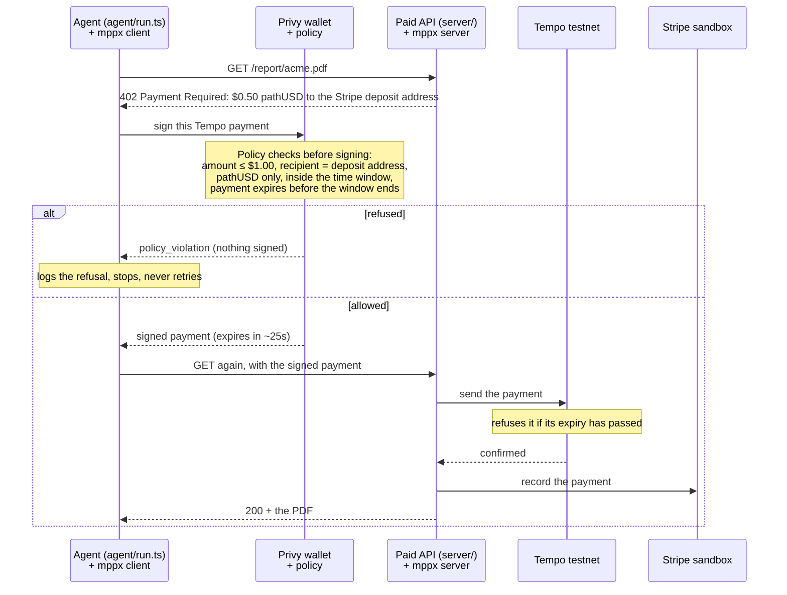

# Allowance (agent-pay-demo)

An agent with a Privy server wallet and a spending policy pays a Stripe-backed API over the Machine Payments Protocol (MPP), in stablecoin on Tempo testnet. Good payments go through and show up in Stripe; bad ones are refused before anything is signed; and a signed payment that a merchant sits on expires on chain.

Test networks and sandboxes only: Stripe sandbox, Tempo testnet, a Privy development app.

## How a payment flows

Two layers enforce the limits:

| Layer | When | What it enforces |
| --- | --- | --- |
| Privy policy | Before signing | Per-payment cap ($1.00), recipient allowlist (the Stripe deposit address), token and fee token (pathUSD), time window |
| Tempo | When the payment executes | The payment's own expiry (`valid_before`), which the policy forces to be set and to fall inside the window |

## Setup

You need Node 20+, a [Privy](https://dashboard.privy.io) development app, and a [Stripe](https://dashboard.stripe.com) sandbox with machine payments enabled.

1. Install: `npm install`
2. `cp .env.example .env`, then fill in:
   - `PRIVY_APP_ID`, `PRIVY_APP_SECRET` from the Privy dashboard (app settings).
   - `PRIVY_AUTHORIZATION_KEY`: create an authorization key in the Privy dashboard and paste its private key. It owns the wallet and the policy, so the app secret alone can't change either.
   - `STRIPE_SECRET_KEY`: a sandbox key (`sk_test_...`). Live keys are refused.
3. Stripe: create a Stripe profile in the sandbox Dashboard, then run `npm run check:stripe -- --create`. Copy the profile ID into `STRIPE_PROFILE_ID` and the Tempo deposit address into `TEMPO_DEPOSIT_ADDRESS`.
4. Wallet: `npm run wallet:create`, then copy `PRIVY_WALLET_ID` and `PRIVY_WALLET_ADDRESS` into `.env`.
5. Funds: `npm run wallet:fund` (Tempo testnet faucet, test pathUSD).
6. Policy: `npm run policy:create` (preset `research-hour` by default). It attaches the policy to the wallet and deletes the one it replaces; scripts read the attached policy from Privy, so nothing needs copying (`PRIVY_POLICY_ID` in `.env` is for reference). The allowance window lasts 1 hour; re-run to open a new one.
7. Check the policy: `npm run check:policy` should print `6/6 cases behaved as expected`.

## Run

Start the paid API in one terminal and run the agent in another.

| Command | What it does |
| --- | --- |
| `npm run server` | Paid API on port 4242: `/report/acme.pdf` ($0.50) and `/report/premium.pdf` ($1.10) |
| `npm run view` | Live spend view at http://localhost:4243: the allowance in force, a countdown (with the dead-zone warning), and every payment attempt with the wallet's decision, updating every 2s |
| `npm run validate` | Checks the server end to end with `mppx validate` (pays from mppx's own test wallet) |
| `npm run agent` | The agent buys the Acme report from the Privy wallet and saves it to `agent/out/` |
| `npm run agent -- --report premium` | Tries the $1.10 report: refused, over the $1.00 cap |
| `npm run agent -- --repeat [--every 5]` | Keeps buying until the wallet refuses, then stops |
| `npm run policy:create -- --window 60` | Opens a 60-second window (pair with `--repeat` to watch it close) |
| `npm run policy:create -- --preset <name>` | Picks a preset: `quick-errand` ($0.50/payment, 15 min), `research-hour` ($1.00, 1h, the default), `all-day-api` ($1.00, 24h). No preset has a total cap (see Known limits) |

Server test modes (each logs that it's on):

| Command | What it shows |
| --- | --- |
| `npm run server -- --lookalike` | A merchant whose 402 asks for an address one character off the real one: refused, not on the allowlist |
| `npm run server -- --hold-payments 30` | A merchant that holds the signed payment for 30s, then sends it to Tempo itself: Tempo rejects it as expired |

Every payment attempt logs one line: time, amount, recipient, decision, reason, reference.

**Presets, policies and mandates.** A *policy* is Privy's: rules attached to the wallet that Privy checks before every signature. A *preset* is this project's: a named set of numbers (per-payment cap, merchant, time window) that `policy:create` turns into a Privy policy. The agent is told its *mandate* separately (read back from the live policy); it never sees the preset, and can't get around the policy whatever it's told.

## Layout

| Folder | What lives there |
| --- | --- |
| `agent/` | The paying agent (`run.ts`), behind the agent interface |
| `view/` | The live spend view (read-only; reads `logs/payments.jsonl` and the attached policy) |
| `server/` | The paid API, adapted from Stripe's [machine-payments sample](https://github.com/stripe-samples/machine-payments) |
| `lib/` | All wallet and policy logic: `policy.ts` (rules), `wallet.ts` (every signature goes through here and is logged), `pay.ts` (MPP client), `tempo.ts`, `agent.ts` (the agent interface), `env.ts` |
| `scripts/` | Setup and checks: create wallet and policy, fund, check Stripe and the policy |
| `evals/` | Phase 3 (eval harness) |

## Known limits

- Stripe records a payment only if it the payment is $0.50 or more, so the report costs $0.50.
- Privy can't enforce a cumulative (daily or total) cap on Tempo transactions, so the policy has per-payment, recipient and time limits only.
- mppx payments expire about 25 seconds after signing, so in the last ~25 seconds of a window the wallet refuses new payments; that's what guarantees none can land after the window closes.

## What's next

Phase 3 turns this into **agent-spend-tests**, an eval kit that measures how often an agent stays inside its spending mandate on its own, and how much the wallet policy catches when it doesn't.

## References

[Privy agentic wallets](https://docs.privy.io/recipes/wallets/agentic-wallets) · [Privy + MPP](https://docs.privy.io/recipes/agent-integrations/mpp) · [Stripe MPP](https://docs.stripe.com/payments/machine/mpp) · [Stripe sample](https://github.com/stripe-samples/machine-payments) · [MPP spec](https://mpp.dev)
